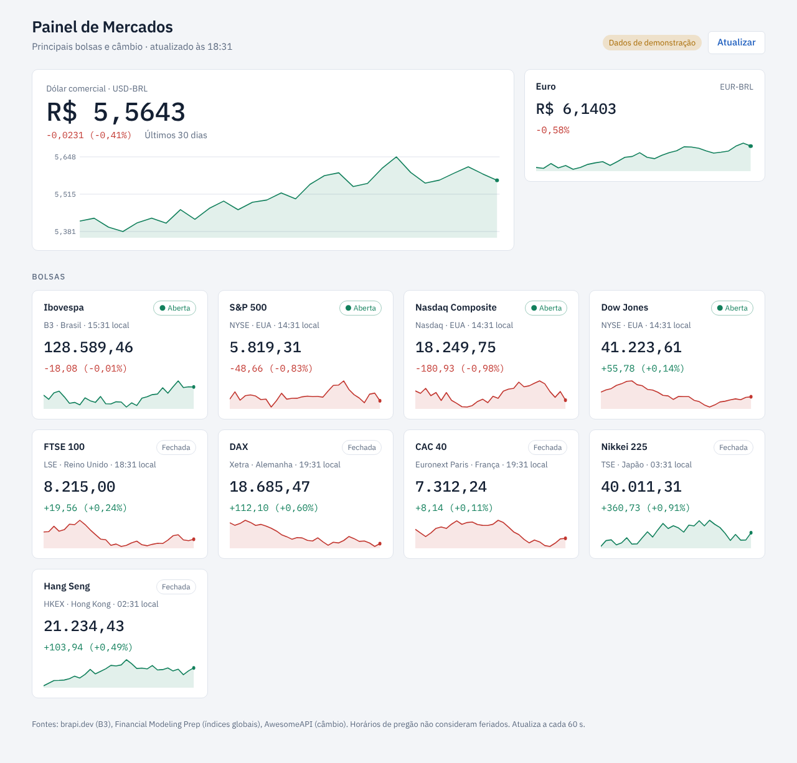

# Painel de Mercados

Dashboard com câmbio (dólar e euro em reais), juros e inflação (Selic, CDI, IPCA), as principais
bolsas (Ibovespa, S&P 500, Nasdaq, Dow Jones, FTSE 100, Nikkei 225, Hang Seng) e commodities
(petróleo Brent e ouro).



## Como rodar

Requer Node.js 20.6 ou superior. Não há dependências para instalar.

```bash
cp .env.example .env    # preencha as chaves
npm start               # http://localhost:3000
```

Para ver o painel sem chaves nem internet: `npm run demo` (dados fictícios, sinalizados na tela).
Sem `DEMO=1`, o painel mostra apenas dados reais.

## Publicar com link fixo (para o painel de BI)

A forma mais simples é a [Vercel](https://vercel.com), plano grátis:

1. Suba este projeto para um repositório no GitHub.
2. Na Vercel: **Add New → Project**, escolha o repositório e clique em **Deploy**
   (não precisa mudar nenhuma configuração; o `vercel.json` já cuida disso).
3. Em **Settings → Environment Variables**, cadastre `BRAPI_TOKEN`, `FMP_API_KEY` e
   `AWESOME_API_KEY`. Depois, em **Deployments**, clique em **Redeploy**.
4. Use o link gerado (ex.: `https://dashboard-bolsas.vercel.app`) no seu painel de BI.

As cotações ficam em cache na CDN da Vercel: não importa quantas telas estejam abertas,
cada fonte é consultada no máximo no ritmo descrito em "Frequência de atualização".

**Opções no link** (podem ser combinadas: `?modo=tv&tema=escuro`)
- `?tema=escuro` ou `?tema=claro` força o tema (por padrão segue o sistema).
- `?modo=tv` encaixa tudo numa tela só, sem rolagem, para TVs e telões em paisagem (ex.: 1920×1080).

**Armazenamento (recomendado):** ligue um Upstash Redis grátis ao projeto na Vercel
(**Storage → Create Database → Upstash for Redis → Connect Project**) e faça um **Redeploy**.
Com ele, as cotações ficam guardadas entre execuções, a última cotação boa cobre falhas das fontes
e a FMP tem um teto rígido de 200 consultas por dia (`DAILY_BUDGET` em `src/config.js`).
Confira em `/api/status`: `"armazenamento": "redis"` e o total de consultas do dia.

**Embutindo no BI**
- *Power BI*: em um **dashboard** (serviço), use **Adicionar bloco → Conteúdo da Web** com
  `<iframe src="https://SEU-LINK.vercel.app/?tema=claro" width="100%" height="100%"></iframe>`.
  Em **relatórios**, use um visual de conteúdo HTML/Web da AppSource que aceite URL.
- *Metabase, Grafana, Looker Studio, Superset*: use o bloco/painel de "iframe", "texto/HTML" ou
  "incorporar URL" com o mesmo link.

## Fontes de dados

Cada ativo tem uma lista de fontes em `src/config.js`, tentadas em ordem até uma responder.

| Dados | Fontes (em ordem) | Chave |
|---|---|---|
| Ibovespa e ativos da B3 | [brapi.dev](https://brapi.dev/docs) | `BRAPI_TOKEN` (plano grátis) |
| S&P 500, Nasdaq, Dow Jones, FTSE 100, Nikkei, Hang Seng | [Financial Modeling Prep](https://site.financialmodelingprep.com/developer/docs) | `FMP_API_KEY` (plano grátis) |
| Selic, CDI, IPCA 12 meses | [Banco Central (SGS)](https://dadosabertos.bcb.gov.br) | Não precisa |
| Petróleo Brent, ouro | Financial Modeling Prep | `FMP_API_KEY` |
| Dólar e euro | brapi → [AwesomeAPI](https://docs.awesomeapi.com.br/api-de-moedas) → [PTAX do Banco Central](https://dadosabertos.bcb.gov.br) → [Frankfurter/BCE](https://frankfurter.dev) | `AWESOME_API_KEY` recomendada (sem ela, na Vercel, o câmbio cai para as cotações diárias) |
| DAX, CAC 40 | Desativados (`enabled: false`): fora do plano grátis da FMP, e a Stooq bloqueia a Vercel | — |

Na Vercel, a AwesomeAPI devolve 429, a Stooq devolve 403 e a FMP grátis não cobre câmbio com real.
A API do Banco Central também costuma não responder a servidores fora do Brasil. Por isso o
`vercel.json` fixa a função na região `gru1` (São Paulo). PTAX e Frankfurter são cotações diárias;
o card mostra qual fonte está em uso.

Se todas as fontes de um ativo falharem, o card mostra **Indisponível** com o motivo. O painel
nunca exibe números fictícios fora do modo demo (`npm run demo`).

## Frequência de atualização

A tela pergunta ao servidor a cada minuto, mas cada cotação só é buscada de novo na fonte quando
seu prazo vence (valores em `REFRESH_MINUTES`, em `src/config.js`):

| Ativo | Pregão aberto | Pregão fechado |
|---|---|---|
| Dólar e euro (AwesomeAPI) | a cada 2 min (09h–18h, horário de Brasília) | guarda a última até a abertura |
| Ibovespa (brapi) | a cada 5 min | guarda a última até a abertura |
| Bolsas globais (FMP) | a cada 30 min | guarda a última até a abertura |
| Brent e ouro (FMP) | a cada 1 h (09h–18h, horário de Brasília) | guarda a última até as 9h |
| Selic, CDI, IPCA (Banco Central) | a cada 6 h | a cada 6 h |
| Gráficos de 30 dias | a cada 12 h | a cada 12 h |

Isso mantém a FMP em torno de 140 consultas por dia, abaixo do limite grátis de 250. Cada card
mostra a fonte e o horário da cotação.

## Como funciona

```
navegador ──/api/assets, /api/quote?id=…, /api/history?id=…──▶ api/*.js (Vercel) ou src/server.js
   ▲   (cotações a cada 1 min, gráficos a cada 30 min)          │ cache da CDN com prazo por ativo
   └──────────────── public/ (HTML, CSS, JS) ◀────────────────── src/markets.js → src/providers.js
```

- A página principal é montada no servidor (`src/page.js`, `api/page.js`) já com os números, e se
  recarrega a cada 5 min. Assim funciona em painéis de BI que não rodam JavaScript. Onde ele roda,
  `public/app.js` atualiza os números a cada minuto sem recarregar.
- O HTML de cada parte fica em `public/render.js`, usado pelo servidor e pelo navegador.
- As chamadas às APIs ficam no servidor: as chaves não vão para o navegador e não há problema de CORS.
- O status "Aberta/Fechada" usa o fuso de cada bolsa. Feriados não são considerados.

## Personalizar

- **Adicionar/remover bolsas ou moedas:** edite `src/config.js`. Ex.: `{ provider: 'brapi', symbol: 'PETR4', ... }`
  para uma ação da B3, ou `{ pair: 'BTC-BRL', name: 'Bitcoin' }` em `CURRENCIES`.
- **Trocar de provedor:** crie em `src/providers.js` um objeto com `quote(símbolo)` e `history(símbolo)`,
  exporte-o e use o nome dele em `sources` no `src/config.js`.

## Estrutura

```
src/config.js      ativos, fusos e horários de pregão
src/providers.js   integração com cada API + dados demo
src/markets.js     escolhe a fonte, define o prazo de cada cotação e as rotas /api/*
src/store.js       armazenamento compartilhado (Upstash Redis na Vercel; memória sem ele)
src/server.js      servidor HTTP local (npm start), com cache em memória
api/*.js           as mesmas rotas como funções serverless da Vercel
public/            estilos, render.js (HTML das partes) e app.js (atualização no navegador)
src/page.js        página completa montada no servidor
```
